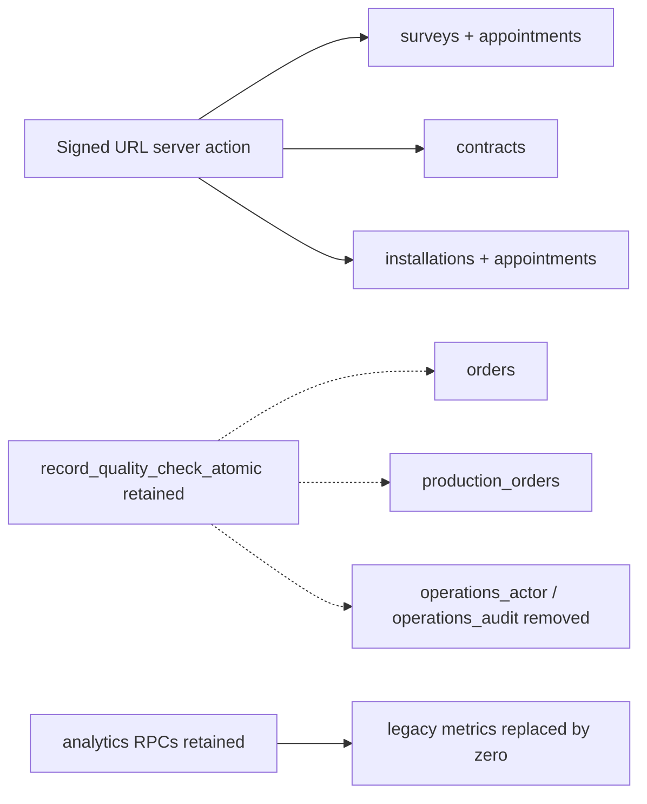

# Meta Ads staging: destructive dependency audit and safe migration plan

**Final recommendation: BLOCKED.**

Audit date: 2026-10-30, Asia/Ho_Chi_Minh. Repository branch:
`meta_ads_integration`, source commit
`48aab3388f69ecd9dd0f8da5546dfb8e25752e22`, [PR #139](https://github.com/hoanganhngo847-a11y/ai-crm-cua-chong-ngap/pull/139).
Database target: **only** Supabase `qmhfmgkymjgoevwmkidm`,
`ai-crm-meta-staging`, PostgreSQL 17.11, ACTIVE_HEALTHY.
This is an audit and proposed plan, not execution authorization.

## A. Executive assessment

The current staging tables are empty in the narrow legacy scope, but the
destructive chain cannot yet be approved as application-compatible:

1. `record_quality_check_atomic(uuid,uuid,text,uuid,text)` is omitted from the
   cleanup's 33-name DROP list. In the **already-existing full local schema** it
   survives with service_role EXECUTE, while its `orders`, `production_orders`,
   `operations_actor` and `operations_audit` dependencies are gone. This is an
   untracked PL/pgSQL dependency and a concrete retained API inconsistency.
2. A browser-facing server action still accepts SURVEY, CONTRACT and INSTALLATION
   signed-URL requests. Its implementation queries tables scheduled for removal.
   The current UI calls RECORDING, which survives; that does not retire the other
   accepted request categories or prove the absence of outside callers.
3. TV9 preserves the three named input keys through a defaulted fourth argument,
   but changes the actual function identity and delivery-time semantics. Adding
   a three-argument wrapper beside that defaulted overload creates an overlapping
   RPC resolution surface; it is not an automatically safe fix.
4. The **current** catalog closure is understood, but staging is 94 historical
   migrations behind the cleanup boundary. Dependencies introduced by approved
   predecessors must be recaptured there. Empty local replay and a current
   catalog graph cannot prove the future live CASCADE set.
5. Destructive approvals, backup/restore proof, outside-consumer ownership,
   runtime/scheduler fencing and an agreed ledger strategy are missing.

### Complete-chain risk counts

Every one of the 116 files was parsed in chronological order. The counting unit
below is **one top-level SQL statement**. Each multi-action ALTER and immediate
DO block retains its suboperations; a function body is distinguished from SQL
executed while applying a migration. Counts do not mean approved actions.

| Assessment | All 2,277 statements | In the 95 pending files |
| --- | ---: | ---: |
| SAFE: no destructive impact identified | 245 | 169 |
| CONDITIONAL: verify dependencies, privileges, data or operational conditions | 1,704 | 1,097 |
| HIGH RISK: data/config/API behavior or permission exposure can change | 205 | 186 |
| BLOCKED: explicit destructive/security-reducing operation needs owner approval | 123 | 105 |

The expanded destructive checklist contains **176 object/subcommand items**:
18 are already-recorded historical inventory, and **158 are pending**. Its
different denominator expands multi-object statements and the 33-name dynamic
DROP loop. Nothing in either list is approved by this report.

Evidence entry points:

- [Full 116-file risk matrix](evidence/meta-ads-dependency-audit/FULL_MIGRATION_RISK_MATRIX.md): every statement, exact source line, classification, reason/action and nested DO rows.
- [Exact SQL inventory](evidence/meta-ads-dependency-audit/migration-risk-statements.json): complete statements, ALTER subcommands, privileges and dynamic expressions, not just table headers.
- [Legacy dependency appendix](evidence/meta-ads-dependency-audit/LEGACY_DEPENDENCY_INVENTORY.md): every current constraint, index, non-internal trigger and policy on the targets, and all 33 pre-removal function signatures/callers.
- [Individual destructive approvals](evidence/meta-ads-dependency-audit/DESTRUCTIVE_APPROVAL_CHECKLIST.md).
- [Repository reference inventory](evidence/meta-ads-dependency-audit/repository-references.json): the entire 861-file tracked repository was searched, including application entry points, libraries, workers, scripts, tests, docs and prior evidence.

The parser is pglast 8.7, using PostgreSQL grammar 18.6, installed outside the
repository. All SQL and all 31 DO blocks parsed successfully. This is offline
syntax/classification, not a claim of PostgreSQL 17 execution or a complete
catalog emulator. The prior authorized PostgreSQL 17 replay/CI is historical
supporting evidence; no replay was performed during this read-only audit.

## B. Revalidated staging and dependency inventory

### Actual tables and row counts

Staging still records **21 migrations**, ending in `operations_p0_hardening`.
The canonical branch contains 116 files; 95 remain pending. The complete
public/private catalog fingerprint still matches the captured canonical
21-file prefix: 460 columns, 298 constraints, 92 application functions,
154 indexes, 86 policies, 45 tables/views and 63 non-internal triggers.
See [history](evidence/meta-ads-dependency-audit/staging-history.json) and
[catalog recheck](evidence/meta-ads-dependency-audit/staging-catalog-recheck.json).

The counts below use actual `COUNT(*)`, not planner estimates or comments.
Queries were separate read-only transactions; they are observations at audit
time, not a locked maintenance snapshot or a guarantee against later writes.

| Target table | Current exact rows | Current application/query impact |
| --- | ---: | --- |
| survey_photo_operations | 0 | Backend photo-operation RPCs and survey-write guard; no literal TS table call found. |
| surveys | 0 | Signed URL SURVEY branch and survey authorization helper; current analytics SQL also reads it. |
| installations | 0 | Signed URL INSTALLATION branch and installation authorization helper. |
| warranty_tickets | 0 | Warranty mutation RPC; no literal runtime TS table call found. |
| production_orders | 0 | Production/QC RPCs; omitted QC RPC survives cleanup incorrectly. |
| contracts | 0 | Signed URL CONTRACT branch and contract authorization helper; generation/signing RPCs. |
| payment_transactions | 0 | Exported payment authorization helper; no call to that helper found in runtime source. |
| operations_outbox | 0 | Backend completion/outbox RPCs; no literal runtime TS table call found. |
| finance_summaries | 0 | Current analytics SQL; cleanup replaces the RPC with zero legacy finance metrics. |
| orders | 0 | Exported order authorization helper and current analytics/operational SQL; retained QC RPC is incompatible after removal. |
| price_calculations | 0 | Commercial calculation/order RPCs; no literal runtime TS table call found. |
| pricing_policies | 0 | Commercial calculation RPCs and immutable/default-policy guards. |
| company_bank_accounts | ABSENT | Introduced by pending commercial foundation; inspect again at cleanup boundary. Absence is not an empty-table count. |
| appointments | 0 | Survey/installation technician authorization and exported appointment helper; current analytics and technician RLS helper. |

All 13 existing tables have RLS enabled. anon SELECT is denied on all 13.
authenticated SELECT is allowed on eleven under policies and denied on
`operations_outbox` and `survey_photo_operations`; service_role SELECT is allowed.
Every actual policy expression, constraint definition and trigger function is
recorded in the per-table JSON and [dependency appendix](evidence/meta-ads-dependency-audit/LEGACY_DEPENDENCY_INVENTORY.md).

### Catalog dependencies and CASCADE scope

The current table set has **89 unique constraints**, including **36 foreign
keys** touching those tables, **46 indexes**, **29 non-internal triggers** and
**33 policies**. All these objects are individually listed in evidence. Foreign
keys include links within the legacy group and links to surviving parent tables
such as companies, customers and user_profiles. No FK on a surviving business
table that references a legacy target was found in this snapshot.

For the 13 present tables plus the 22 currently present function targets, a
read-only pg_depend traversal produced **472 candidate object addresses**:

| Catalog category | Candidate addresses |
| --- | ---: |
| Tables/indexes/TOAST relations, pg_class | 81 |
| Constraints | 89 |
| Column defaults | 48 |
| Policies | 33 |
| Functions | 22 |
| Triggers, including RI implementation triggers | 173 |
| Row and array types | 26 |

The 173 triggers include 29 user triggers and 144 internal RI triggers. **44
internal RI triggers are on surviving parent tables**. Their removal is expected
cleanup of the legacy foreign keys; it does not mean deleting the parent tables
or their rows. Eleven TOAST tables and their indexes are also implementation
objects, not unexpected business tables. The closure contains no view or
materialized-view rewrite object and no other surviving business relation.

This is a **candidate closure**, not a DROP dry run or an exact emulation of all
PostgreSQL deletion rules. It traverses reverse normal/automatic/internal and
partition dependencies and internal-owner links. Extension membership, pinned
objects, event-trigger behavior and subsequent DDL require separate checks.
Definitions and object identities are retained in
[direct edges](evidence/meta-ads-dependency-audit/staging-direct-dependencies.json)
and [closure candidates](evidence/meta-ads-dependency-audit/staging-cascade-candidates.json).

PostgreSQL does not track every reference inside string-defined function bodies.
That is why the QC function can survive while its referenced objects disappear;
the same limitation applies to external API and application consumers.
[PostgreSQL dependency tracking](https://www.postgresql.org/docs/17/ddl-depend.html)
and [dependency types](https://www.postgresql.org/docs/17/catalog-pg-depend.html).

The complete current FK graph, including external parents and the dangling QC
body references, is [available as Mermaid](evidence/meta-ads-dependency-audit/legacy-dependencies.mmd).
The key application relationship is:



### All dynamic function targets

The cleanup's `pg_proc.proname IN (...)` selects **33 names and every overload
of each name**, not a frozen signature set. The canonical static timeline has
one matching overload for each name immediately before cleanup. Staging
currently has 22; eleven are introduced by pending predecessors.

All 33 full signatures, last-definition file/line, table references, function
callers and live presence are tabulated in the
[function section of the appendix](evidence/meta-ads-dependency-audit/LEGACY_DEPENDENCY_INVENTORY.md#dynamic-function-targets).
They cover:

- Appointment/survey: `accept_installation_appointment_atomic`,
  `begin_survey_photo_operation`, `complete_survey_atomic`,
  `create_installation_schedule_atomic`, `end_survey_photo_operation`,
  `guard_survey_appointment_write`, `is_assigned_technician`,
  `start_installation_work_atomic`.
- Commercial: `claim_contract_generation_rpc`,
  `create_order_from_calculation_rpc`, `finalize_contract_signing_rpc`,
  `finalize_generated_contract_rpc`, `generate_order_code`,
  `process_payment_webhook_rpc`, `save_price_calculation_rpc`,
  `update_order_deposit_rpc`.
- Operations: `complete_installation_atomic`, `create_production_order_atomic`,
  `create_warranty_ticket_atomic`, `mutate_installation_atomic`,
  `operations_actor`, `operations_audit`, `operations_evidence_ref`,
  `update_production_progress_atomic`, `update_warranty_status_atomic`.
- Immutable/integrity trigger functions:
  `enforce_appointments_immutability`, `enforce_contracts_immutability`,
  `enforce_installations_integrity`, `enforce_orders_immutability`,
  `enforce_payment_facts_immutability`, `enforce_price_calculations_immutability`,
  `enforce_pricing_policies_immutability`, `enforce_surveys_integrity`.

No literal runtime TS/JS RPC call to those 33 names was found. This is narrower
than proving they are unused: SQL bodies, table defaults, triggers, RLS and
clients outside the repository still matter. Dynamic query names and generic
RPC helper calls were separately reviewed in
[dynamic-name review](evidence/meta-ads-dependency-audit/dynamic-name-review.json).
The entire chain also has 40 explicit function-DROP targets outside that loop;
their application/test consumers are joined in
[all function-DROP consumers](evidence/meta-ads-dependency-audit/all-function-drop-consumers.json).

An additional overload created outside this repository would be selected by the
name-only loop. At the execution boundary, require the live expanded signature
set to equal the approved manifest exactly; any extra overload is a stop gate.
Do not assume stable loop iteration order or rely on CASCADE to discover scope.

## C. TV9 compatibility assessment

The destructive statement is
`20260928000002_tv9_post_merge_hardening.sql:664`, ID **M022-S020**:

```sql
DROP FUNCTION IF EXISTS public.resolve_response_sla_on_sale_reply(uuid, uuid, uuid);
```

The replacement starts at line 666. Both return the same 16 named result columns
and use SECURITY DEFINER with an empty search_path. Both are service_role APIs;
anon/authenticated execution is denied by their final ACLs.

| Stage | Actual identity | Input/default | Behavior |
| --- | --- | --- | --- |
| Current staging, 21-file prefix | `(uuid,uuid,uuid)` | Three required named parameters | Validates tenant/conversation/customer and outbound SALE message; resolves at interaction.created_at. |
| TV9 | `(uuid,uuid,uuid,timestamptz)` | Same three required names; p_resolved_at defaults to NULL | If Hán outbox exists, requires SENT with valid sent_at and ignores caller timestamp. Otherwise uses supplied timestamp not before interaction time, or interaction time. |
| Later canonical definition, `20261001160001...:483` | Same four-argument identity | Same default | Retains delivery-time checks and yields when the AI dispatch fence is active; clears fence state when Sale wins. |

### Precise caller/compatibility matrix

| Consumer / evidence | Three-argument staging | Four-argument canonical schema | Risk / decision |
| --- | --- | --- | --- |
| `response-sla-store.ts:110`, three JSON keys | Resolves current function | Optional fourth key permits the same request shape | Parameter compatible; behavior can now reject an unconfirmed outbox. Helper throws on RPC errors. No runtime importer of this exported helper was found outside tests. |
| Direct three-key tests at `response-sla-db.test.ts:948,959,970,981,1057` | Function exists; role checks apply | Request shape still resolves; anon/auth remain denied | These tests are consumers, not proof that current production/external clients use it. |
| Four-key tests at `facebook-sla-runtime.test.ts:1286,1372,1442,1513` and `response-sla-db.test.ts:1047` | No matching four-argument function | Valid request shape | These newer tests cannot be run unchanged against the prefix. |
| Wrapper tests at `current-system.integration.test.ts:375,508` and `response-sla-db.test.ts:346,361` | Three-key wrapper | Same named-key compatibility | Business assertions must account for provider confirmation/fence behavior. |
| Historical DB caller `han_finish_send` at TV9 line 925 and `20261001170001...:366`, `20261001180001...:391` | Not the prefix implementation | Supplies four arguments explicitly | Transient callers during replay, not all surviving callers. |
| Final `han_finish_send`, `20261002100001...:13` | Different older implementation | Updates SLA inline at lines 96–111; no resolver call remains | Current Messenger send entry in `facebook/server.ts:345` must be tested through its final owner/fence semantics, not assumed to exercise this resolver. |
| Existing SQL three-positional/named invocation | Three identity exists | Fourth default can satisfy a three-input call | Read-only EXPLAIN on the existing local full schema resolves three named keys to four inputs with NULL. No function execution occurred. |
| Exact `regprocedure` lookup, stored OID, dependency on three identity | Exists | Three identity is absent | Incompatible despite JSON-call compatibility. No such current catalog dependent was found; outside consumers remain unknown. |
| Background workers / scheduler code | No direct resolver-name call found | No direct call found | Indirect SQL paths and outside scheduled/manual consumers still need owner attestation. |
| Generated database types | None found in tracked repository | None found | Clients use unparameterized Supabase clients/manual DTOs; TypeScript cannot certify database identity compatibility. |

Current staging has exactly one overload, three inputs, zero incoming pg_depend
edges, anon/authenticated EXECUTE false and service_role EXECUTE true.
[Live signature evidence](evidence/meta-ads-dependency-audit/staging-tv9-signatures.json).
No current staging function body references this resolver name. The full source
timeline likewise has no surviving function-body caller after the final
`han_finish_send` rewrite. Neither observation proves zero application or
outside-client dependencies.

The two read-only local EXPLAIN plans for
[three keys](evidence/meta-ads-dependency-audit/local-three-key-resolution-plan.json)
and [four keys](evidence/meta-ads-dependency-audit/local-four-key-resolution-plan.json)
prove name/type resolution only. Live PostgREST routing, schema cache, JWT roles
and business state transitions were **not** exercised during this audit.

### Compatibility wrapper design

Preferred expand/contract design, if retaining the old API is required: a
distinctly named v2 core with the reviewed delivery/fence logic, and an in-place
three-input wrapper preserving its parameter names, 16-column result and
service-only ACL. The wrapper explicitly delegates with a NULL timestamp.
Keep both APIs during a measured deprecation period and update callers to the
versioned name. Do not silently preserve the old false-SENT semantics.

Avoid adding a same-name three-input wrapper beside the already-defaulted
four-input overload. PostgREST matches JSON keys against required/optional
parameter sets; both can match the same payload. Upstream resolver code reviewed
for v14.13 rejects multiple matching routines; deployed cloud version/cache are
not verified here. See [PostgREST functions/defaults](https://docs.postgrest.org/en/stable/references/api/functions.html)
and [upstream overload matching](https://github.com/PostgREST/postgrest/blob/v14.13/src/PostgREST/Plan.hs#L219-L268).
The existing local image is PostgREST v16.4; no claim is made that its source or
the cloud instance was independently tested with the overlapping pair.

Also, PostgreSQL 17 rejects removing an existing default through CREATE OR
REPLACE. Replacing the defaulted fourth argument with a required argument is
therefore not a free additive workaround after TV9 has run.
[PostgreSQL 17 implementation](https://github.com/postgres/postgres/blob/REL_17_STABLE/src/backend/catalog/pg_proc.c#L470-L491).

Critically, adding a later wrapper does not remove the earlier immutable DROP
from the chain. Preserving the original three-input identity **through** that
boundary would need a separately reviewed superseding execution/history plan;
do not edit TV9, skip it, fake an applied entry, or disguise the DROP.

## D. Legacy removal, residual consumers and retention

### Concrete retained API defect

`record_quality_check_atomic(...)` is defined at
`20260928000001_operations_p0_hardening.sql:75`, but is absent from the cleanup's
line-527 list. Its body declares legacy row types, queries/updates both legacy
order tables and calls operations_actor/operations_audit. On the pre-existing
116-file local database the function still exists and service_role can execute
it, while both tables and those helpers have been removed.
[Local metadata/source evidence](evidence/meta-ads-dependency-audit/local-existing-schema-orphan-rpc.json).
The body was inspected, not invoked. No claim is made of a newly executed
business failure test.

Required future remediation: choose a reviewed retirement/tombstone response or
explicitly remove the unused API after its consumers are accounted for. If the
operation must remain functional, the referenced data/workflow cannot be
contracted away. Any new function replacement/revoke/DROP needs separate
approval and a forward-only migration; this audit makes none.

The current prefix also contains an older `schedule_installation_atomic`, which
is removed by a preceding pending migration before the replacement
`create_installation_schedule_atomic` is created. Applying the cleanup directly
to the prefix would miss that sequencing and leave additional broken body
references. The cleanup must never be cherry-picked out of its approved chain.

### Every literal runtime legacy table query

| File | Exact query lines | Tables |
| --- | --- | --- |
| `lib/server-auth/resource-access.ts` | 228, 274 | appointments |
| same | 307, 333, 363 | surveys, appointments, surveys |
| same | 396, 422, 452 | installations, appointments, installations |
| same | 480, 499 | orders |
| same | 527, 546 | contracts |
| same | 575, 594 | payment_transactions |
| `lib/sensitive/signed-urls.ts` | 79, 107 | surveys, contracts |

These 16 queries are not all active UI flows. Appointment/order/payment helper
exports have no runtime caller found. Survey/contract/installation authorization
is called by the signed URL implementation, which is called by
`lib/sensitive/action-handlers.ts:82`, then exported through
`app/actions/sensitive.ts:51–55`. `CallHistoryTable.tsx:67` currently supplies
RECORDING. The legacy categories remain accepted by the shared request type and
server action, so removal needs an explicit category-retirement or compatibility
decision, not dead-code assumptions.

Reporting retains public analytics function names and JSON shape, but the
cleanup's replacements at lines 6 and 335 remove survey/order/finance queries
and emit zero legacy metrics. `features/analytics/services/analytics-store.ts:56,89`
still calls them; KPI/finance/operations components still render those keys.
This avoids a missing-table query, but changes the meaning of displayed zero.
The owner must approve module retirement and the UI/reporting semantics.
Customer 360's timeline is replaced at cleanup line 477; AI Brain's
`getUpcomingAppointments` at `context-supabase.ts:177` already returns an empty
array. These are intentional source-level removals, not evidence about outside
clients or historical data retention.

### Storage, audit and external dependency limits

- `installation-docs` exists, is private and has zero objects. `survey-photos`
  and `contracts` buckets are absent now; pending migrations provision them.
  Current storage policies are the three installation evidence deny policies.
  No current storage policy refers to the target tables/functions. Dropping a
  database table does not retire a storage API or preserve its canonical file
  references automatically. Inventory again before contraction.
- Named legacy resource types in audit_logs currently have zero matching rows.
  This count does not attest free-form metadata, alternative labels, exports,
  backups, retention obligations or external file references. No row payloads
  or object names were retrieved.
- There is no `cron.job` relation and pg_cron/pg_net are not installed on staging
  now. Conditional scheduler branches therefore are not currently provisioned.
  The SQL contains future recurring Messenger scheduling and network-dispatch
  helpers; enabling those extensions later changes the execution conditions.
  No Vault secret value was read.
- Outside SQL clients, workers not represented in this repo, Render/control-plane
  schedules, PostgREST cloud version/cache and signed-action request telemetry
  were not inventoried. The missing evidence is a blocker to a claim of no
  service disruption, not proof that those consumers exist or do not exist.
- No backup or restore was performed in this task. Obtain owner retention
  requirements for contracts/payments/financial records, audit histories,
  storage objects and any staged imports. Empty current tables do not prove
  future emptiness, lawful disposal or restoration readiness.

## E. Full migration risk matrix and operational hotspots

The [complete matrix](evidence/meta-ads-dependency-audit/FULL_MIGRATION_RISK_MATRIX.md)
and [exact SQL](evidence/meta-ads-dependency-audit/migration-risk-statements.json)
are part of this report. They cover all 116 files and every non-SAFE statement,
not only the cleanup. File SHA-256 values bind the inventory to the audited SQL.
Policy drops, trigger drops, column/constraint drops, schema/function renames,
grants/revokes, RLS changes, storage changes, extension operations and data/config
transforms all have their own records. CREATE FUNCTION body DML is marked as
runtime behavior; immediate DO operations are separately expanded, including
constant dynamic SQL and variable format templates.

Selected gates that an empty-database replay would conceal:

| Exact location | Operation / evidence | Required action |
| --- | --- | --- |
| `20260928000002_tv9_post_merge_hardening.sql:664`, M022-S020 | Remove three-input resolver identity | Approve API identity/behavior transition and cache/consumer plan separately. |
| `20260929120003_zalo_round3_remediation.sql:40–68` | Copy newest OA credentials to private store, then drop public plaintext columns | Verify encrypted/restricted backup and row/version preservation without logging values; inspect actual source columns. |
| same file:925–942 | Copy raw outbound payloads, sanitize public content | Reconcile row counts/content hashes and recovery policy; do not assume data-free staging forever. |
| `20261001160001_ai_sale_fencing_linearization.sql:20,372–373` | Replace active AI dispatch/provider-result RPC signatures | Current worker callers exist; require parameter/ownership/fence and retry regressions. |
| `20261002220001_commercial_exactly_once_and_recovery.sql:22–37` | Clone calculations and rebind order calculation IDs inside DO | Back up relationships, audit rows and uniqueness/amount invariants. |
| `20261023170000_ai_brain_messenger_live_canary_and_scheduler.sql:1003` and `20261028130001...:570` | Conditional scheduler setup, grants and recurring Messenger dispatch | Verify extensions, job manifests, endpoint isolation and paused execution; no secret retrieval in audit output. |
| `20261028130000_customer_funnel_six_stages.sql:191,205,229,282` | Stage mapping/history/audit transforms | Compare tenant/stage counts and preserve original histories; approve business mapping. |
| `20261028130001_remove_messenger_pending_sale_gate_and_enable_pages.sql:493,554` | Seed allowlist and enable Messenger AI settings | Fence all sends/jobs during replay; explicitly approve configuration effects before resuming. |
| `20261028140000_fix_messenger_confidence_and_sla_resolution.sql:13` | Change Messenger min_confidence to 0.700 | Approve behavior change independently of DDL correctness. |
| `20261028150000_always_reply_messenger_fallback_and_no_pause.sql:130` | Reactivate paused Facebook AI conversations | Must not accidentally re-enable replies during database validation. |
| `20261029120000_zcajs_groups_and_zalo_ai_pause.sql:422,430` | Disable Zalo AI and terminally skip in-flight deliveries | Preserve outcome/retry audit; prevent conflicting runtime changes. |
| `20261029160000_remove_legacy_flood_barrier_schema.sql:529`, M111-S015 | Dynamic DROP FUNCTION CASCADE, 33 names | Approve each expanded signature and live dependency set; resolve QC omission and API consumers first. |
| same file:534–549, M111-S016 | DROP TABLE CASCADE, 14 names | Individually approve all 14 after retention, storage, FK, caller and backup gates. |
| `20261030100000_meta_ads_hardening.sql:34,47–48` | Migrate token rows and drop public token columns | Verify complete vault copy/key compatibility through a secret-capable operator; this audit retrieved no values. |
| `20261030110000_meta_ads_final_remediation.sql:684` | Replace sync-lease release API used by marketing-sync.ts:519,530 | Verify stale-owner fencing and crash/partial-failure recovery before deployment. |

No top-level TRUNCATE or DELETE statement was found. DELETE inside stored
functions is runtime behavior; an ON DELETE CASCADE foreign-key action is not
the same operation as a DROP ... CASCADE. No concurrent index build was found.
Index/constraint validation and nonconcurrent build locks still need live-data
and timeout planning.

## F. Proposed safe ordered execution plan

Every step below that changes schema, data, settings, jobs, deployment or history
requires a **new explicit approval**. None was executed here.

1. **Choose the compatibility/retirement contract before SQL.** Resolve the
   retained QC API and signed-URL categories; decide whether historical finance
   and operations APIs must remain functional. Obtain ownership acknowledgments
   for outside consumers, a measurable deprecation period and expected error
   behavior. Freeze the audited source hashes and target project ID.
2. **Choose a chain/history route.** The 21 live entries use application-time
   versions, not canonical filenames. Preserve them. A reviewed append-only
   route can apply each genuinely pending canonical file and retain a mapping
   of canonical version/name/hash to the normal newly assigned ledger version.
   It must execute actual complete SQL, enforce order, and never infer application
   from names alone. Blind CLI db push, repair, fabricated entries and skipping
   destructive statements are not acceptable. Separately validate the chosen
   tool's schema/history atomicity and handling of files with their own BEGIN /
   COMMIT. This audit does not certify a particular executor implementation.
3. **If old identity/data must be retained, do not force the immutable chain.**
   An additive versioned core plus old wrapper is feasible as an API design,
   but the historical DROP is still present. Require a separately reviewed
   superseding/history strategy, or an approved parallel staging rebuild/cutover
   retaining the existing database and backups. A later forward-only file alone
   cannot prevent earlier loss. No alternative route may bypass a safety gate.
4. **Establish staging-only maintenance fencing.** Verify the effective staging
   Render/database pairing without displaying secrets. Pause staging ingress,
   scheduler and worker execution through an approved control plane; drain or
   fence in-flight provider claims and prevent sends. Keep production untouched.
   Do not weaken RLS or grant browser access for migration convenience.
5. **Take an encrypted staging-only backup.** Include a consistent database
   schema/data snapshot, roles/grants/functions/policies/triggers, sequence state,
   relevant private stores and protected storage object/reference manifests.
   Protect key material through the secret manager, not Git/chat/logs. Record
   backup identity and restoration procedure without retrieving secrets here.
   Restore into an explicitly approved disposable target and demonstrate
   row/hash/foreign-key and authorized retrieval recovery before contraction.
6. **Preflight at the real execution boundary.** Re-run exact row counts, complete
   catalog/ACL/RLS checks, unknown-object detection and external-consumer checks.
   Require no unapproved object or overload. Check existing data for every
   constraint/index change, and separately approve all data/config transforms.
7. **Rehearse after approval.** Use both a clean platform database and a clone of
   the real 21-entry staging prefix, with representative synthetic legacy data,
   file references, cross-tenant actors and pending jobs. Exercise proposed
   wrappers/tombstones and failure injection. The current empty replay is not
   sufficient. Do not copy production data.
8. **Apply only the approved ordered files while fenced.** Use per-file hashes,
   migration ledger evidence and explicit pre/post conditions. Prevent application
   access to intermediate ACLs/definitions. Keep the safety mechanism active;
   if it rejects an operation, stop and use its supported human review process,
   never another spelling or route around it. Stop on the first mismatch/error.
9. **Add a specific pre-contraction barrier.** After the approved predecessors,
   recapture the complete 14-table and 33-function live graph. Confirm row counts
   again, prove backup/retention sign-off, ensure QC/API remediation is included
   in the approved cutover sequence, and approve the exact actual signatures and
   collateral objects. Do not run cleanup directly on today's prefix.
10. **Post-conditions before resuming staging traffic.** Verify every approved
    migration is actually applied, catalog/ACL/RLS and function results match,
    no surviving body references removed objects, old/new RPC clients resolve,
    storage authorization works, tenant/role denial holds, jobs remain paused
    until explicitly resumed, and Meta token/claim/attribution/report RPCs pass.
    Check PostgREST cache refresh through the supported mechanism after approval;
    no schema-cache change was sent here.
11. **Recover by state, not by guessing down migrations.** Before an atomic
    transaction commits, a validated transaction rollback can restore its own
    database effects; it cannot undo external side effects. Explicit COMMITs and
    historical per-file boundaries prevent a blanket whole-chain rollback.
    After contraction, an old application alone cannot restore removed data or
    functions. Keep staging fenced, use the tested backup/parallel target,
    restore dependency order and storage references, reconcile ledger/schema
    from evidence, and rerun acceptance. Never mark a partial operation applied
    to conceal failure. Any history repair is a separate reviewed decision.

## G. Regression plan and individually approvable actions

This task executed only offline audit assertions and read-only catalog/count/
EXPLAIN checks. It did not execute business mutations or create a test database.
The following are required future behavior tests, subject to separate approval:

| Scenario | Required business assertion |
| --- | --- |
| Three-key and four-key RPC via real PostgREST | Old named request remains compatible as approved; no ambiguous overload/cache gap; same result contract. |
| TV9 old/new state semantics | SENT uses canonical outbox time; backdating ignored; SENDING/FAILED/UNKNOWN denied; generic timestamp validation and no-open-window idempotency hold. |
| Dispatch concurrency | Active AI fence yields correctly; Sale/provider winner is unique; stale owners cannot resolve/release work. |
| Tenant and roles | Cross-company conversation/customer/interaction cannot resolve; anon/SALE/BOSS browser roles denied where API is service-only; wrapper grants do not widen. |
| Signed URL contract | Supported SURVEY/INSTALLATION/CONTRACT/RECORDING requests work or return the explicitly approved retirement result; same-tenant, assignee, AAL2, TTL and file-reference constraints remain enforced. |
| Legacy trigger/FK behavior | Synthetic non-empty legacy rows preserve tenant/immutability protections until approved retirement; no unapproved external FK/policy/trigger collateral loss. |
| QC API | It either remains functional with preserved dependencies or returns the approved retired-module contract; no dangling relation/helper lookup remains. |
| Reporting/timeline | Users can distinguish retired metrics from true zero; timeline/history retention and company scoping remain as agreed. |
| Background workers and scheduled jobs | Claim, completion, retries and scheduler health use surviving RPC signatures; no provider send before explicit unpause. |
| Clean and prefix replay | Exact same approved chain builds clean and upgrades the real prefix; all source/hash-to-ledger mappings and final grants are verified. |
| Partial failure and recovery | Inject a failure before/after each commit boundary; no partial ledger success, no duplicate stage/audit/lead events, no stale-owner writes; restore succeeds. |
| Metadata idempotency | Reapply only migrations explicitly designed for it; never rerun unguarded activation/history transforms by filename guess. |

Existing tests to extend include `tests/response-sla/response-sla-db.test.ts`,
`facebook-sla-runtime.test.ts`, `tests/e2e/current-system.integration.test.ts`,
`tests/staging/migration-security-db.test.ts` and
`tests/omnichannel/meta_ads_db.integration.test.ts`. Their DB fixtures mutate
state, so they were not run under this audit's restrictions. No application,
migration, workflow or existing test file was changed.

Approval items are separate, not one blanket yes:

- **TV9 API identity/semantics:** M022-S020 plus any explicitly reviewed wrapper,
  deployment and schema-cache sequence.
- **Legacy functions:** each of the 33 named signatures in M111-S015.function1–33,
  with actual live overload/dependency equality at the cleanup boundary.
- **Legacy tables:** each of the 14 targets in M111-S016.object1–14, including
  each table's rows, constraints, indexes, triggers, policies and row types.
- **Retained API remediation:** QC RPC behavior/retirement and signed-URL category
  compatibility; analytics/timeline semantics need owner acknowledgment too.
- **Other pending destructive statements:** every remaining unchecked item in
  [the 158-item pending checklist](evidence/meta-ads-dependency-audit/DESTRUCTIVE_APPROVAL_CHECKLIST.md),
  including credential columns, constraints, policies and RPC replacements.
- **Data/config changes, operations and recovery:** the HIGH RISK/CONDITIONAL
  matrix rows, staging maintenance/backup/restore, any compatibility deployment,
  ledger mapping executor and each worker/scheduler unpause require their own
  reviewed scope. Approval to drop one function does not authorize any of these.

## H. Decision and audit completion

**BLOCKED.** The empty current legacy tables reduce immediate row-loss exposure;
they do not make the 116-file chain safe to apply without remediation and
approval. The QC omission, retained signed-URL contract, outside-consumer and
future-boundary dependency gaps, retention/restore gates and version-ledger
strategy remain unresolved.

Completed: all 116 files/31 DO blocks reviewed; every destructive statement
inventoried; all 14 tables and 33 dynamic function targets investigated; TV9
overloads/callers/business changes documented; repository consumers searched;
actual staging counts/schema/ACL/RLS/storage/dependencies revalidated; unknowns
and ordered recovery/approval plan recorded. Supporting scripts only read source
and write documentation evidence.

No pending migration, DROP, CASCADE, db push, repair, schema change, staging reset,
production connection/change, secret retrieval, deployment, PR merge or CI bypass
was performed. No existing migration SQL or application business logic changed.
No push was performed: this audit only leaves new local documentation/evidence
on the requested branch, avoiding an automatic application deployment.
