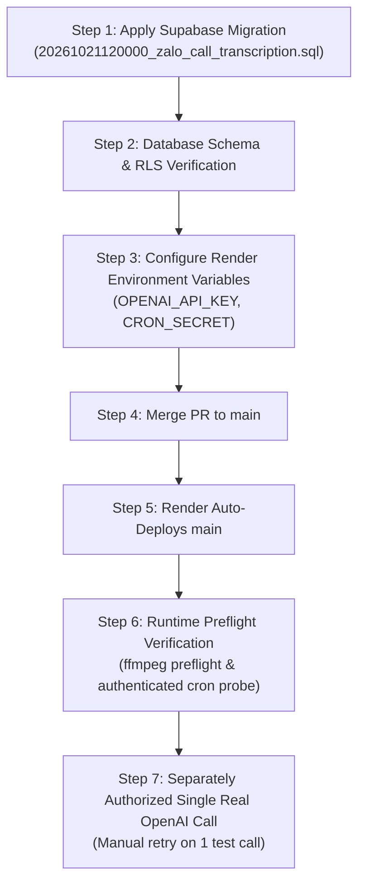

# Zalo Call Transcription Phase 1: Operational Runbook & Production Architecture

This document defines the production runtime architecture, configuration, security contracts, and operational rollout sequence for Zalo call transcription in Phase 1.

---

## 1. Stereo Audio Architecture & Speaker Mapping

Zalo personal recording files (`.m4a`, AAC) captured by the desktop capture agent preserve discrete channel isolation:
- **Left Channel (Channel 0 / FL):** ScreenCaptureKit system audio capture = **Remote / CUSTOMER**
- **Right Channel (Channel 1 / FR):** AVCaptureSession microphone capture = **Local / STAFF**

### Discrete Channel Splitting & Merging
1. `splitStereoChannels` executes deterministic channel splitting via `ffmpeg` using `channelsplit=channel_layout=stereo` into two mono `.m4a` files.
2. The original recording file in Supabase Storage (`zalo-call-recordings`) is **never modified or deleted**.
3. Each active channel is transcribed independently with timestamps relative to the start of the recording.
4. Segments from both channels are deterministically merged and ordered chronologically by `start_ms ASC`. Ties are broken deterministically by sequence.
5. If both channels are silent according to recorder metadata (`audio_validation`), transcription completes immediately with zero utterances and an empty transcript; speech is **never manufactured**.

---

## 2. Provider Configuration & Model Specifications

### Required Server-Only Environment Variables
The following environment variables are strictly server-only and must never be exposed to the browser or prefixed with `NEXT_PUBLIC_`:

| Variable | Required | Default in Code | Purpose |
| :--- | :---: | :---: | :--- |
| `OPENAI_API_KEY` | **Yes** | None (Fails closed) | Secret API key for OpenAI transcription endpoint. Never logged or echoed. |
| `OPENAI_TRANSCRIPTION_MODEL` | No | `whisper-1` | Model identifier for OpenAI speech-to-text. |
| `CRON_SECRET` | **Yes** (Prod) | None (Fails closed 503) | Shared secret for authenticating automated cron worker calls. |

### Default Model & Timestamp Compatibility
- **Exact Default Model:** `whisper-1` (hardcoded default in `OpenAITranscriptionProvider`).
- **Response Format:** `verbose_json`.
- **Timestamp Support:** `whisper-1` provides segment-level start and end timestamps (`segments[].start`, `segments[].end`) required for dialogue reconstruction.
- **Official Deprecation Notice & Compatibility Risk:**
  - OpenAI officially announced deprecation of `whisper-1` on August 26, 2026.
  - The API shutdown / retirement date is **February 26, 2027** (official guide: https://developers.openai.com/api/docs/guides/speech-to-text).
  - OpenAI points developers toward `gpt-transcribe` / `gpt-live-transcribe`.
  - **Compatibility Rationale for Phase 1:** `whisper-1` is deliberately retained for this release because its `verbose_json` segment timestamp format is fully verified in our test suite. Switching to `gpt-transcribe` requires verifying segment timestamp schema parity and should be handled in a follow-up phase prior to February 2027. We document this deprecation and lifecycle boundary here and in the PR risks.
- **Model Override Notice:** Do **not** override `OPENAI_TRANSCRIPTION_MODEL` to chat/completion models or unverified audio preview models without verifying verbose JSON segment timestamp support.

---

## 3. Audio Size Safety & Phase 1 Limitations

- **Conservative Upload Limit:** Exactly `25_000_000` bytes (decimal 25 MB ceiling).
- **Enforcement Layers:**
  1. **Post-Split Channel Gate:** Mono buffers for each channel (`customerAudio` and `staffAudio`) are checked immediately after splitting before any provider API call.
  2. **Pre-Upload Provider Gate:** `OpenAITranscriptionProvider.transcribe` validates `audioBuffer.length <= MAX_PROVIDER_AUDIO_BYTES`.
- **Oversized Audio Behavior:**
  - If either mono channel exceeds `25_000_000` bytes, the job is permanently classified with error code `AUDIO_TOO_LARGE`.
  - The provider is **not** called, consuming zero API credits.
  - The original recording file is preserved intact.
  - Phase 1 does **not** perform audio chunking or compression. Calls exceeding 25 MB require manual review or future chunking implementation.

---

## 4. FFmpeg Production Strategy & Linux Runtime Preflight

### Production Packaging Strategy
1. **Pinned Dependency:** `ffmpeg-static` is pinned to exact version `5.3.0` in both `package.json` and `package-lock.json`.
2. **Next.js Turbopack Packaging Proof:** `serverExternalPackages: ['ffmpeg-static']` is configured in `next.config.ts`. This ensures Turbopack and webpack treat `ffmpeg-static` as a native external Node.js module rather than bundling a static path like `/ROOT/node_modules/ffmpeg-static/ffmpeg`.
3. **Deterministic Binary Resolution:**
   - Priority 1: `process.env.FFMPEG_PATH` (explicit override)
   - Priority 2: `require('ffmpeg-static')` (project-managed Linux x64 binary vendored in `node_modules` during `npm ci`)
   - Priority 3: `/opt/homebrew/bin/ffmpeg` (local Darwin development fallback only)
   - **No undocumented Linux PATH fallback:** System paths like `/usr/bin/ffmpeg` are not probed on Linux. If the binary is missing or unexecutable, the job fails with `FFMPEG_UNAVAILABLE`.

### Pure FFmpeg Preflight vs Cron Invocation (Crucial Operational Distinction)

#### 1. Pure FFmpeg Runtime Preflight (No External Provider Calls, Zero Credits)
To verify ffmpeg binary readiness on Render Linux without touching the job queue or spending OpenAI credits, run a pure preflight probe:
```bash
node -e "const { validateFfmpeg } = require('./features/zalo-transcription/audio-splitter'); console.log('FFmpeg OK:', validateFfmpeg());"
```
This pure preflight verifies:
- File existence via `existsSync(binaryPath)`
- Execution permissions via `execFileSync(binaryPath, ['-version'])` with a 5,000 ms timeout
- Output matching `/ffmpeg version (\S+)/`

---

## 5. Worker Bounding, Leases & Concurrency Fencing

### Execution Time Limits & Deadline Propagation
- **Total Worker Duration:** `MAX_WORKER_DURATION_MS = 240_000` ms (4 minutes).
- **Single Job Duration:** `MAX_SINGLE_JOB_DURATION_MS = 180_000` ms (3 minutes).
- **Download Timeout:** Bounded by `AbortSignal.timeout(Math.min(60_000, remainingJobMs))`.
- **FFmpeg Split Timeout:** Bounded by `child_process.execFileSync` option `timeout: Math.min(60_000, remainingJobMs)`.
- **Provider Request Timeout:** Bounded by combined `AbortSignal.timeout(Math.min(120_000, remainingJobMs))` and job deadline.
- **Sequential 1-at-a-Time Claims:** The cron worker claims only **1 immediately processable job** per iteration (`p_limit: 1`) up to the invocation batch cap (`limit = 10`). This guarantees each job begins processing with a fresh 300-second lease, preventing sequentially claimed jobs from expiring in memory while earlier jobs run.
- **No `Promise.race` Runaway Writes:** Timeouts directly abort in-flight network requests and process executions. Uncoordinated `Promise.race` patterns are avoided, ensuring background tasks cannot hang and perform runaway database writes.

### Concurrency Fencing & Lease Safety
- **Postgres SKIP LOCKED:** `zalo_claim_transcription_jobs` selects due jobs using `FOR UPDATE SKIP LOCKED`.
- **Lock Token Fencing:** Each claim generates a cryptographic `lock_token = gen_random_uuid()` and sets `lease_expires_at = now() + interval '300 seconds'`.
- **Completion & Failure Fencing:** Both `zalo_complete_transcription` and `zalo_fail_transcription` require matching `lock_token` and `status = 'PROCESSING'`. If a lease expires and another worker reclaims the job, the stale worker's write is rejected with `TRANSCRIPTION_LOCK_LOST`.

---

## 6. Historical Recordings & Idempotency Behavior

- **Historical Recordings Default:** All existing recordings created before this migration have `transcript_status = 'NOT_STARTED'`. They are **never automatically enqueued**.
- **New Recordings Enqueuing:** Only newly finalized calls through `zalo_finish_recording` transition to `transcript_status = 'PENDING'`.
- **Manual Backfill / Retry:** An authorized `BOSS_ADMIN` or owning `SALE` agent can explicitly trigger transcription for historical or failed calls via `POST /api/voice/zalo-personal/transcriptions/retry` (which calls RPC `zalo_retry_transcription`).
- **Database Idempotency:** The unique constraint `uq_zalo_call_transcriptions_call (company_id, call_id)` prevents duplicate queue entries.

---

## 7. Authenticated Cron Invocation Runbook

### Authentication Contract
The cron endpoint `/api/cron/zalo-transcription` accepts both `GET` and `POST` methods:
- Requires header: `Authorization: Bearer $CRON_SECRET`
- Authenticated via constant-time comparison (`crypto.timingSafeEqual`) to prevent timing side-channel attacks.
- In production (`NODE_ENV === 'production'`), requests without `CRON_SECRET` configured return `503 Service Unavailable`.
- Requests with missing or invalid tokens return `401 Unauthorized`.

### Safe Manual Invocations (Using Variables, No Literal Secrets)
Run the following commands using environment variables in terminal or deployment scripts:

```bash
# 1. Manual verification using GET
curl -X GET \
  -H "Authorization: Bearer ${CRON_SECRET}" \
  https://${RENDER_APP_DOMAIN}/api/cron/zalo-transcription

# 2. Manual verification using POST
curl -X POST \
  -H "Authorization: Bearer ${CRON_SECRET}" \
  https://${RENDER_APP_DOMAIN}/api/cron/zalo-transcription
```

Expected JSON response:
```json
{
  "ok": true,
  "processed": 0,
  "failed": 0
}
```

---

## 8. Schema-First Rollout Sequence

Render automatically deploys commits merged to `main`. If code is merged before database schema changes are present in production, the application will experience runtime errors when calling non-existent tables and RPCs.

Therefore, the rollout **MUST** follow this exact schema-first sequence:



### Rollout Step Details:
1. **Apply Supabase Migration:** Execute `supabase/migrations/20261021120000_zalo_call_transcription.sql` on the production database.
2. **Database Verification:** Confirm table creation (`zalo_call_transcriptions`, `zalo_call_transcript_utterances`), column addition (`zalo_personal_calls.transcript_status`), and RPC grants (`service_role` execute only).
3. **Configure Environment Variables:** In Render Dashboard, ensure `OPENAI_API_KEY`, `OPENAI_TRANSCRIPTION_MODEL` (`whisper-1`), and `CRON_SECRET` are configured.
4. **Merge PR:** Merge feature branch `zalo_call_transcription_phase_one` into `main`.
5. **Render Auto-Deployment:** Allow Render build and deployment to complete successfully.
6. **Pure FFmpeg Runtime Preflight (Zero Credits Spent):** Execute the pure preflight command in Render environment (or run test suite) to verify `ffmpeg-static` binary execution and version without calling external APIs or claiming jobs:
   ```bash
   node -e "const { validateFfmpeg } = require('./features/zalo-transcription/audio-splitter'); console.log(validateFfmpeg());"
   ```
7. **Separately Authorized Single Real OpenAI Call:**
   - Verify that all historical recordings remain in `NOT_STARTED` and the queue has 0 unverified jobs.
   - With explicit user authorization, select exactly one test call in the CRM UI and click **Thử lại** (or call `POST /api/voice/zalo-personal/transcriptions/retry`).
   - Trigger the cron worker once (`curl -X POST -H "Authorization: Bearer ${CRON_SECRET}" https://${RENDER_APP_DOMAIN}/api/cron/zalo-transcription`) to process this single authorized job.
   - Verify OpenAI transcription output and utterance timestamps in the CRM UI.
8. **Ongoing Scheduled Cron Activation:** Only after Step 7 succeeds, configure the recurring automated cron schedule on Render.
