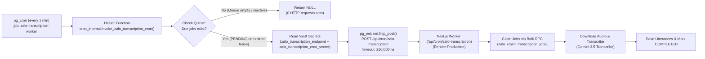
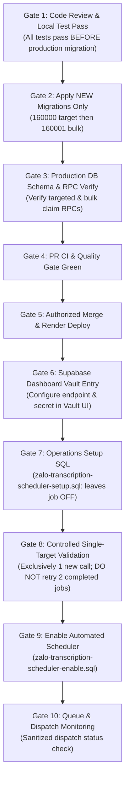

# Zalo Personal Call Transcription: Phase 2A Automated Scheduler Runbook

This runbook defines the architecture, deployment sequence, operations SQL, security posture, and observability for the automated 1-minute recurring scheduler for Zalo call transcription.

---

## 1. Executive Summary & Architecture

Phase 2A automates recurring execution of the Zalo transcription worker (`/api/cron/zalo-transcription`) using Supabase-native PostgreSQL extensions (`pg_cron` and `pg_net`) and Supabase Vault:
- **Cadence:** 1-minute recurring cron schedule (`* * * * *`).
- **Conditional Dispatch:** Outbound HTTP requests occur **strictly when eligible work exists** (due `PENDING` jobs or reclaimable expired `PROCESSING` leases with linked `READY` audio recordings and valid attempt budgets). If no work is due, zero network requests are dispatched.
- **Privilege Isolation:** Admin helper function lives in a private nonexposed schema (`cron_internal`) with `SECURITY DEFINER` and `search_path=''`. Execution is revoked from `PUBLIC`, `anon`, `authenticated`, and `service_role`; executable strictly by `postgres` (and `supabase_admin`).
- **Zero Secrets in SQL / Cron Command:** Bearer token and HTTPS endpoint are dynamically retrieved from Supabase Vault at runtime using exact names (`zalo_transcription_endpoint`, `zalo_transcription_cron_secret`). The `cron.job.command` contains only `SELECT cron_internal.invoke_zalo_transcription_cron();`.
- **Cost Accounting & Billing Transparency:**
  - **No New Paid Infrastructure:** No additional paid service plans or external schedulers are added; `pg_cron` and `pg_net` run inside existing Supabase PG17 compute.
  - **Existing Usage Costs Apply:** Existing database compute, Render web dyno runtime, and Google AI Studio Gemini API token consumption continue to incur their normal usage costs under existing accounts (this is not a claim of $0.00 total system cost).
  - **Alternative Schedulers Evaluated & Rejected:**
    - *Render Cron Jobs:* Minimum $1.00/month per job plus spin-up overhead => rejected.
    - *GitHub Actions Scheduled Workflows:* Minimum interval is 5 minutes (cannot achieve 1-minute cadence) with documented runner jitter => rejected.
    - *Vercel Cron:* Free tier limited to daily schedule cadence; cannot achieve 1-minute recurring interval => rejected.
- **Latency Realities:**
  - A 60-second polling cadence (`* * * * *`) results in an average queue wait time of ~30 seconds for due jobs.
  - Polling every 60s **does not guarantee** completion within 1–2 minutes. Total end-to-end processing duration depends on audio download time from Supabase Storage, stereo ffmpeg channel splitting, Gemini 3.5 Transcribe API latency, and database persistence.



> [!NOTE]
> **Claim Mode Contract:** The automated recurring scheduler triggers bulk processing via `zalo_claim_transcription_jobs`. The bulk RPC delegates individual claims to `zalo_claim_transcription_job`; controlled single-target validation calls that RPC directly (Gate 8 via `?transcription_id=`). A fresh installation remains inactive until Gate 9 execution. See [production acceptance](./ZALO_TRANSCRIPTION_PHASE2A_ACCEPTANCE.md) for the dated rollout result.

---

## 2. API Contract: `/api/cron/zalo-transcription`

The worker endpoint processes due transcription jobs from the queue (bulk) or targets a single specific job (targeted).

### Endpoint Details
- **Path:** `/api/cron/zalo-transcription`
- **Methods:** `POST` (primary scheduler invocation), `GET` (diagnostic / manual verification)
- **Headers:**
  - `Authorization: Bearer <CRON_SECRET>`
  - `Content-Type: application/json`

### Authentication Specification
- **Constant-Time Verification:** Uses `node:crypto.timingSafeEqual` to verify the bearer token against `process.env.CRON_SECRET`, preventing timing side-channel attacks.
- **Fail-Closed:** Returns `503 Service Unavailable` if `CRON_SECRET` is unset in the environment. Missing or invalid Bearer tokens return `401 Unauthorized`. Authentication executes prior to query parameter validation.

### Query Parameters (Query String ONLY)
The endpoint strictly accepts parameters via URL search parameters. It does **not** accept body parameters or parameter aliases:

| Parameter | Type | Validation / Rules | Description |
|---|---|---|---|
| `transcription_id` | UUID string | Must match `/^[0-9a-f]{8}-[0-9a-f]{4}-[0-9a-f]{4}-[0-9a-f]{4}-[0-9a-f]{12}$/i`. Invalid UUID returns `400 Bad Request`. | Targeted mode: claims and processes **strictly** this designated job once with no fallback to bulk. |
| `limit` | Integer string | Must match `/^(?:[1-9]\|10)$/` (integer 1 to 10, default 10). Invalid values return `400 Bad Request`. | Bulk mode: maximum number of due jobs claimed in a single batch. |

- **Duplicate Query Parameters:** Any duplicated query parameter returns `400 Bad Request`.
- **Targeted Mode Precedence:** If both `transcription_id` and `limit` are supplied, `limit` is validated (must be 1..10) and rejected with 400 if invalid; if valid, it is ignored during execution because targeted mode claims only the designated single job.
- **No Body / Alias Parameters:** Parameter aliases are not permitted or supported. Request bodies are not parsed for parameters.

---

## 3. Operations SQL & Vault Security Architecture

The scheduler is managed through three dedicated SQL files located in `docs/sql/`. These files are executed **outside automated migrations** via the Supabase SQL Editor or `psql` by an authorized database administrator.

### File Manifest
1. `docs/sql/zalo-transcription-scheduler-setup.sql`:
   - Transactionally enables `pg_cron` and `pg_net` extensions and configures hardened private schema `cron_internal`.
   - Creates bounded table `cron_internal.zalo_transcription_dispatch_history` and sanitized view `cron_internal.zalo_transcription_dispatch_status` (pending requests yield `has_error = NULL`).
   - Creates helper function `cron_internal.invoke_zalo_transcription_cron()` with `SECURITY DEFINER SET search_path = ''`. Includes all expired `PROCESSING` leases and due `PENDING` jobs with remaining attempt budget.
   - Revokes execution from `PUBLIC`, `anon`, `authenticated`, and `service_role`; grants to `postgres` and `supabase_admin` when present.
   - Attempts defense-in-depth revocation on `net`; managed owner grants can remain. Validates private `cron_internal` isolation and `anon`/`authenticated` NOLOGIN, and reports retained managed grants without claiming a zero ACL.
   - **Important:** Setup leaves the recurring scheduler uncreated.
2. `docs/sql/zalo-transcription-scheduler-enable.sql`:
   - Requires the external API preflight below, validates private schema isolation and NOLOGIN, and checks prerequisites: extensions installed, BOTH new migrations applied in order (targeted claim `public.zalo_claim_transcription_job` and bulk lease recovery `public.zalo_claim_transcription_jobs`), validates bulk wrapper behavior via `pg_get_functiondef` without queue invocation, helper function ACLs enforced, and Vault configuration **VALUES** are valid (HTTPS endpoint ending in `/api/cron/zalo-transcription`, secret >= 16 chars).
   - Idempotently registers `zalo-transcription-worker` running `* * * * *` with command `SELECT cron_internal.invoke_zalo_transcription_cron();`.
3. `docs/sql/zalo-transcription-scheduler-disable.sql`:
   - Idempotently unschedules strictly `zalo-transcription-worker`, leaving all other jobs intact.

### Managed Supabase permissions and external preflight

Hosted `pg_net` objects are owned by `supabase_admin`. A nonsuperuser `postgres` session cannot revoke that owner's grants; PostgreSQL can emit warnings and leave PUBLIC privileges intact. The SQL reports these retained managed grants. It does not claim that REVOKE always removes them. Metadata inspection uses `information_schema.table_privileges`, since `role_table_grants` omits PUBLIC grants.

The [official Supabase permissions guide](https://supabase.com/docs/guides/database/extensions/pg_net#permissions) explains the supported client-access boundary: `net` is excluded from the Data API and `anon`/`authenticated` are NOLOGIN roles. The scheduler's private schema, function, and monitoring objects additionally deny client roles and `service_role`.

Before enable, verify the actual API boundary using only the public publishable/anon key. Do not add `net`, `cron_internal`, or `vault` to exposed schemas. An administrator SQL session does not reliably prove the active external PostgREST configuration. Recheck after API configuration or extension changes.

```bash
# Supply SUPABASE_URL and SUPABASE_ANON_KEY securely; do not print key values.
node --input-type=module <<'JS'
const base = process.env.SUPABASE_URL;
const key = process.env.SUPABASE_ANON_KEY;
if (!base || !key) throw new Error('Public API configuration required');
for (const schema of ['net', 'cron_internal', 'vault']) {
  const response = await fetch(`${base}/rest/v1/http_request_queue?select=id&limit=0`, {
    headers: { apikey: key, 'Accept-Profile': schema },
    signal: AbortSignal.timeout(20000),
  });
  const result = await response.json();
  console.log(JSON.stringify({ schema, status: response.status, code: result.code }));
  if (response.status !== 406 || result.code !== 'PGRST106') process.exitCode = 1;
}
JS
```

Expected: all three schemas return HTTP 406 / PGRST106, command exit 0. This probe requests only `id` with `limit=0`; it never queries secret-bearing headers or response content. Private schema permissions and NOLOGIN assertions must also pass. Retained managed `net` grants alone are not an API-exposure finding.

### Supabase Vault Configuration Guide
Configure exact named secrets in the Supabase Dashboard Vault UI (**Project Settings -> Vault -> Add new secret**):
1. **Name:** `zalo_transcription_endpoint`
   - **Description:** `Zalo transcription cron HTTPS endpoint`
   - **Value:** `https://<render-app-domain>/api/cron/zalo-transcription` (strictly HTTPS, no query/fragment/whitespace)
2. **Name:** `zalo_transcription_cron_secret`
   - **Description:** `Bearer token matching Render CRON_SECRET`
   - **Value:** `<secret string matching Render production environment>`

> [!CAUTION]
> Never write plaintext secrets in SQL files, pull requests, or terminal logs. Verify secret presence using metadata only:
> `SELECT name, created_at, updated_at FROM vault.decrypted_secrets WHERE name IN ('zalo_transcription_endpoint', 'zalo_transcription_cron_secret');`

---

## 4. Strict Deployment Dependency Sequence (Gate Order)

To eliminate runtime errors and protect existing production queue state, execute rollout strictly in this sequence:



### Detailed Gate Specifications

#### Gate 1: Mandatory Code Review & Test Verification (PRE-MIGRATION)
All tests, typechecks, security reviews, and static analysis must pass locally and in code review before touching production:
```bash
npm run typecheck
npm run test:zalo-recordings
npm run test:security
npm run test:auth
npm run build
git diff --check
npm run test:cron-auth
npm run test:zalo-transcription:pg-concurrency
```

#### Gate 2: Apply NEW Migrations Only (In Order)
Apply strictly the two new migrations in order in Supabase SQL Editor:
1. **Targeted Claim RPC:** `supabase/migrations/20261021160000_zalo_targeted_transcription_claim.sql`
2. **Bulk Lease Recovery Wrapper:** `supabase/migrations/20261021160001_zalo_bulk_transcription_lease_recovery.sql`
- **Warning:** Do **NOT** re-run already-applied non-idempotent baseline migrations (`20261021120000_zalo_call_transcription.sql` or `20261021150000_zalo_transcription_provider_model.sql`).

#### Gate 3: Production DB Schema & RPC Verification
Verify that both targeted and bulk claim RPCs exist and permissions are restricted to `service_role`:
```sql
SELECT
  p.proname,
  pg_get_function_identity_arguments(p.oid) AS arguments,
  r.grantee,
  r.privilege_type
FROM pg_proc p
JOIN pg_namespace n ON n.oid = p.pronamespace
LEFT JOIN information_schema.routine_privileges r
  ON r.routine_schema = n.nspname AND r.routine_name = p.proname
WHERE n.nspname = 'public'
  AND p.proname IN ('zalo_claim_transcription_job', 'zalo_claim_transcription_jobs');
```

#### Gate 4: PR CI & Quality Gate Pass
Ensure all CI checks on the feature branch are green.

#### Gate 5: Authorized Merge & Render Deployment
- Merge authorized PR into `main`.
- Confirm Render deployment status is `Live`.
- Confirm Render environment variables: `TRANSCRIPTION_PROVIDER=GEMINI`, `GEMINI_API_KEY`, `GEMINI_TRANSCRIPTION_MODEL=gemini-3.5-transcribe`, and `CRON_SECRET`.

#### Gate 6: Supabase Dashboard Vault Entry
Add `zalo_transcription_endpoint` and `zalo_transcription_cron_secret` in the Supabase Dashboard Vault UI.

#### Gate 7: Operations Setup SQL
Execute `docs/sql/zalo-transcription-scheduler-setup.sql` in Supabase SQL Editor. Check private schema isolation and NOLOGIN. Retained managed `net` grants are informational, not a claim that REVOKE succeeded. Fresh setup creates no recurring job; reapplying setup does not disable an existing schedule.

#### Gate 8: Controlled Single-Target Validation
> [!IMPORTANT]
> **Production Queue State (Baseline Snapshot):**
> - Verified baseline snapshot (as of 2026-10-21 inspection): Production queue contains **2 COMPLETED jobs only**.
> - Do **NOT** retry, clear, or modify the two existing completed baseline jobs.
> - Execute verification on **strictly ONE newly initiated call** or designated authorized test call.

1. **Pre-Flight Snapshot:** Inspect queue state:
   ```sql
   SELECT id, call_id, company_id, status, attempts, provider, model, created_at
   FROM public.zalo_call_transcriptions
   ORDER BY created_at DESC;
   ```
2. **Execute Controlled Single Target:**
   ```bash
   curl -X POST \
     -H "Authorization: Bearer ${CRON_SECRET}" \
     -H "Content-Type: application/json" \
     "https://${RENDER_APP_DOMAIN}/api/cron/zalo-transcription?transcription_id=${TARGET_TRANSCRIPTION_ID}"
   ```
3. **Post-Flight Validation Criteria:**
   - Pre-existing jobs remain unmodified.
   - Targeted job transitioned: `status = 'COMPLETED'`, `provider = 'GEMINI'`, `model = 'gemini-3.5-transcribe'`, `utterances > 0`.
   - Stereo mapping verified: Left channel = `CUSTOMER`, Right channel = `STAFF`.
   - Linked call in `zalo_personal_calls` has `transcript_status = 'COMPLETED'`.
   - Audio file in Supabase Storage (`zalo-call-recordings`) is intact and unmodified.

#### Gate 9: Enable Automated Scheduler
Run the mandatory external API preflight above and require all three PGRST106 denials. Then execute `docs/sql/zalo-transcription-scheduler-enable.sql` in Supabase SQL Editor. Confirm registration in `cron.job`:
```sql
SELECT jobid, jobname, schedule, active, command
FROM cron.job
WHERE jobname = 'zalo-transcription-worker';
```

#### Gate 10: Queue & Dispatch Monitoring
Verify ongoing runs using sanitized monitoring queries.

---

## 5. Observability, Diagnostics & Monitoring

### Core Operational Principle
> **`pg_cron` execution success (`SELECT 1`) only proves SQL enqueueing, NOT HTTP delivery or job completion.**

### Correlating HTTP Dispatches Reliably & Privately
Because `pg_cron` returns `SELECT 1` without capturing the `pg_net` request ID, `cron_internal.invoke_zalo_transcription_cron()` records dispatched request IDs into bounded table `cron_internal.zalo_transcription_dispatch_history`.

To monitor dispatch outcomes without exposing raw URLs, tokens, audio data, or error details, query the sanitized view:
```sql
-- Sanitized dispatch monitoring query (safe for logs and operational dashboards)
SELECT
  request_id,
  status_code,
  timed_out,
  has_error,
  created
FROM cron_internal.zalo_transcription_dispatch_status
ORDER BY created DESC
LIMIT 10;
```

> [!WARNING]
> **Data Privacy & Sanitization Rule:**
> Never query `content` or `headers` from `net._http_response` or `net.http_request_queue`. These tables may contain Authorization Bearer tokens, signed storage URLs, customer identity information, or raw transcription text.

### Monitoring pg_cron Job Details
```sql
SELECT
  jobid, runid, job_pid, status, return_message, start_time, end_time
FROM cron.job_run_details
WHERE jobid = (SELECT jobid FROM cron.job WHERE jobname = 'zalo-transcription-worker')
ORDER BY start_time DESC
LIMIT 10;
```

---

## 6. Emergency Runbook: Immediate Disabling & Rollback

If unexpected worker failures, provider outages, or queue anomalies occur, disable the automated scheduler immediately without redeploying application code.

### Immediate Disabling (SQL)
Execute `docs/sql/zalo-transcription-scheduler-disable.sql` in the Supabase SQL Editor:
```sql
DO $$
BEGIN
  IF EXISTS (SELECT 1 FROM cron.job WHERE jobname = 'zalo-transcription-worker') THEN
    PERFORM cron.unschedule('zalo-transcription-worker');
    RAISE NOTICE 'Scheduled job zalo-transcription-worker has been unscheduled successfully.';
  ELSE
    RAISE NOTICE 'Scheduled job zalo-transcription-worker was not found (already disabled).';
  END IF;
END $$;
```

### Verification of Disabling
```sql
SELECT count(*) AS remaining_zalo_cron_jobs
FROM cron.job
WHERE jobname = 'zalo-transcription-worker';
-- Expected result: 0
```

### In-Flight Request Drainage
In-flight worker executions will complete within their 4-minute maximum window (`MAX_WORKER_DURATION_MS = 240_000`). Database locks clear automatically upon lease expiration (`lease_expires_at` default 300s).

---

## 7. Official Documentation References

- **Supabase Scheduled Functions (pg_cron):** https://supabase.com/docs/guides/functions/schedule-functions
- **Supabase pg_net Extension:** https://supabase.com/docs/guides/database/extensions/pg_net
- **Render Cron Jobs Documentation & Pricing:** https://render.com/docs/cronjobs
