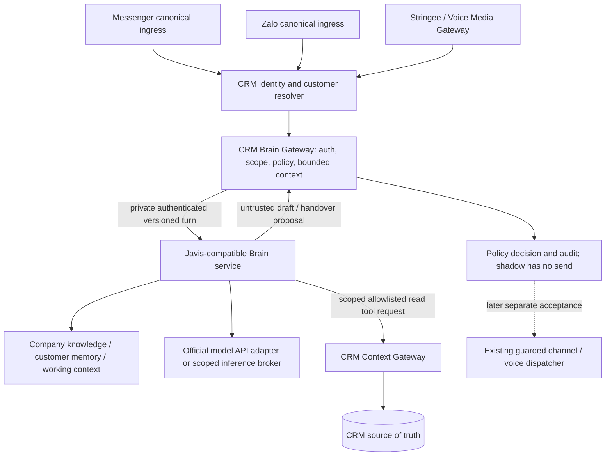

# Shared CRM AI Brain — architecture and staged integration

Status: Phase 0 design; no live Brain, channel wiring, migration, provider call, or automation enabled.
Audit date: 2026-10-22 (Asia/Ho_Chi_Minh).
CRM source baseline: `182c63ea20ad908f5eb9aaa432d5bd8da06b6a85` (PR #73).
Javis source baseline: [`a0561b0c3a8f593f205946a1f1356887d72b5a1a`](https://github.com/blogminhquy/javis-os/tree/a0561b0c3a8f593f205946a1f1356887d72b5a1a).

## 1. Decision and scope

Keep CRM as the sole authority for customers, identities, leads, pipeline, conversations,
messages, calls, staff, permissions, business records and audit. Build a provider-neutral
Brain boundary and a separately deployable Python/FastAPI-compatible service for selected
Javis patterns. Do not fork the desktop assistant into this application. FastAPI is a target
service option, not an infrastructure deployment authorized by this document.

The first implementation is a server-only contract and in-process service boundary. Trusted
execution context comes exclusively from a server-owned authorization resolver, separately
from untrusted turn input. No service-to-service authentication is simulated in Phase 1a.
It has no
production callers, database access, model calls, send operation or deployed HTTP listener.
Subsequent PRs add authenticated transport, CRM read tools, storage and then shadow ingestion.
Publicly reachable Next.js routes do not become private merely by having `/internal` in a URL.
Actual private ingress and workload identity must be verified before enabling transport.

No production environment variables, credentials, schedules, historical data or behavior are
changed here. The presence of existing AI send/voice code is not evidence those capabilities
are enabled or accepted in the current production environment. No production configuration
or database was inspected for this audit.

## 2. Current CRM architecture: observed source

Paths below are relative to the pinned CRM baseline; inspect the latest migration definition
when several files replace the same RPC. Foundation migrations remain frozen.

| Area | Evidence | Integration implication |
| --- | --- | --- |
| Authentication | `lib/auth/context.ts:getActorContext`, `lib/server-auth/sensitive-context.ts:resolveTrustedActor`, `authorize.ts:verifyActorForCompany` | `getUser`, active profile/membership, role and MFA are resolved server-side. An interface brand is not runtime authentication. Preserve operation-specific AAL2 rules. |
| Resource access | `lib/server-auth/resource-access.ts:authorizeCustomerAccess`, `features/omnichannel/facebook/server.ts:authorizeConversation` | Derive resource company from trusted lookup, authorize before full projection; preserve masked cross-tenant not-found behavior. Company membership alone does not imply unrestricted transcript access. |
| Privileged database access | `lib/supabase/admin.ts:createAdminClient` | Server-only service-role bypasses RLS. It stays in CRM and every tool must independently enforce scope. Never pass its key/client to Brain. |
| CRM records | `supabase/migrations/20260914000001_initial_schema.sql:218-413` | `customers`, `identities`, `conversations`, `interactions`, `calls` use company keys; composite FKs bind child records to company/customer. Private contacts and raw interaction content are separated. |
| Tenant RLS/ACL | `20260915000001_rls_foundation.sql`, `20260915000002_trusted_server_private_rpc.sql`, later ACL restoration/hardening migrations | Existing migrations provide evidence of intended controls, not a hosted audit. New storage requires additive RLS/ACL migrations and real database authorization tests. |
| Inbox persistence | `features/inbox/services/inbox.service.ts:addInboundMessage` (atomic RPC at line 1703); latest replacement `20261013230001_dual_fingerprint_idempotency.sql` | Resolve customer/conversation and dedupe in trusted atomic ingestion. Observe only committed canonical interactions. Do not create a parallel Javis customer database. |
| Messenger | `features/omnichannel/facebook/{binding,core,server,transport}.ts`, `app/api/webhooks/meta/` | Keep exact Page-to-company bindings, provider signature checks, official transport and existing delivery receipts/outbox. Legacy/reference Facebook adapter is not the sole active integration. |
| Zalo messaging | `features/omnichannel/zalo/{webhook-handler,webhook-verifier,oa-mapping,inbox-service,outbound-dispatcher,zcajs-client}.ts` | OA and Personal/zcajs transports have distinct trust/identity sources. Normalize a verified CRM interaction for Brain, not raw payload tenant claims. |
| Existing AI reply | `features/automation/response-sla/services/ai-response-runtime.ts:299-430`; `20261001160001_ai_sale_fencing_linearization.sql` and later dispatch migrations | Existing runtime claims SLA, analyzes customer, builds style context, calls model and dispatches through guarded paths. Do not route it through Brain yet or run two send owners. Hard-coded domain prompts are existing debt, not templates for generic Brain. |
| Customer analysis | `features/ai-analysis/services/{analysis-worker,ai-analysis-engine,ai-analysis-store,validate-ai-analysis}.ts` | Sanitized, bounded input RPC and validated append-only output are useful patterns. Calling analysis is not a read-only tool: it runs a model and persists results. Expose only already persisted authorized summaries later. |
| Sales style | `features/sales-style/services/{runtime-style-context,sales-style-activation}.ts` | Existing activated style is a possible approved knowledge source, not unrestricted self-learning or a reason to replace company policy. |
| Zalo Personal recording | `features/zalo-recordings/{metadata,access,upload}.ts`, `20261020073819_zalo_personal_recordings.sql`, `20261020203000_zalo_outbound_call_requests.sql`, `20261020220005_zalo_outbound_recording_hardening.sql` | Separate from legacy `calls` and Stringee. Inbound remains DISPLAY_NAME_ONLY. Only CRM-validated confirmed mapping/outbound request context authorizes a customer link; name similarity does not. SALE recording access is staff-scoped. |
| Transcription/summary | `features/zalo-transcription/`, `features/zalo-summary/`, migrations through `20261022130000_zalo_transcription_channel_checkpoints.sql` | Preserve original private audio, customer/staff stereo labels, leases, retry/checkpoint behavior and existing summary schemas. Derived summaries are evidence/inferences, not verified memory facts. |
| Provider keys | `features/gemini-key-pool/service.ts:32-150`, `20261022090000_gemini_api_key_pool.sql` | CRM key pool decrypts server-side and uses privileged claim/result RPCs. Brain must not receive that pool, master key, service role, or browser keys. Future inference broker may reuse it inside CRM. |
| Voice | `features/voice/services/{integration-resolver,webhook-processor,media-pipeline,realtime-handler,call-dispatcher}.ts`; `providers/stringee-provider.ts`; `docs/VOICE_OPERATIONS.md` | Opaque routing token resolves integration company, signatures bind provider. Existing Realtime accept handler and domain intake are separate from shared Brain. Code/docs do not prove a functioning PSTN/SIP deployment. |

The local checkout used by the user has unrelated uncommitted agent/migration changes and
was behind main. Audit/deliverables use an isolated worktree; those changes are preserved.
Baseline Verify succeeded for exactly `182c63e`: [run 39721616776](https://github.com/hoanganhngo847-a11y/ai-crm-cua-chong-ngap/actions/runs/39721616776).
That result does not establish future feature-branch CI or production acceptance.

## 3. Javis suitability and source evidence

The independent worker audit, when available, is recorded in `JAVIS_AUDIT.md`. The decisions
below also rely on direct Codex inspection of the pinned upstream source.

| Component | Observed implementation | Decision |
| --- | --- | --- |
| Architecture | [`ARCHITECTURE.md`](https://github.com/blogminhquy/javis-os/blob/a0561b0c3a8f593f205946a1f1356887d72b5a1a/ARCHITECTURE.md) describes API and subscription engines, FastAPI, filesystem brain and MCP hub | Reuse orchestration concepts; no whole-server embed. Treat its claims as a map to code. |
| Memory retrieval | `server/memory_index.py:1-5,103-145,424-506` uses Markdown authority plus SQLite derived index and scope-qualified queries. `capability_registry.py:34-40` derives brain scope from a resolved, case-folded path hash | Adapt retrieval/ranking/source references. It does have brain scoping; it does not supply the required CRM company/customer ACL. Path hashing is not authorization. Avoid claiming it has no isolation at all. |
| Learning | `server/learn.py:930-1010,1220-1268` extracts typed facts with provenance/confidence and writes qualifying items to brain files | Adapt extraction/candidate schema and dedupe ideas. Do not import automatic fact promotion or filesystem writes. Model confidence/provenance is a claim until CRM validates actual source ownership. |
| Sessions | `server/sessions.py:38-42,128-164,1207,1854` uses SQLite sessions/messages with brain/channel and optional brain filtering | Adapt session abstraction; reject direct shared session store for customers. CRM scope must be mandatory on every lookup/resume/search, independent of provider thread IDs. |
| MCP hub | `server/mcp_hub.py:1-10,42-53,64-80` provides shared tool routing, local hub token, cache keyed by mode/vault root | Adapt dispatch/audit pattern only. Do not expose connector discovery or vault/coding tools to customer inference. A hub token does not bind company/customer/turn. |
| Permissions | `server/mcp_catalog.py:536-553` enforces permission/mode in code; `full` allows all. `mcp_store.py:101,155,240,590` contains full defaults and JSON registry | Reject defaults/classification as CRM authorization. Use exact named allowlist, strict argument schemas and default deny even for unknown read-looking names. |
| Chatbots/inbox | `server/chatbot_runtime.py:1-25,562-586` and `server/chatbot_store.py` have bot/account/sender audience and plugin context; `server/conversations.py:65-125` has channel-account-scoped SQLite customers/messages | Adapt channel-neutral turn handling and human intervention ideas. CRM owns identity, conversation and permission state; do not use bot sender IDs as cross-channel customer IDs or enable its automatic send runtime. |
| Model routing | `server/model_router.py:1-16,46-97,101-160` defines declared capability/data-class filters, per-step routing and canary policy | Adapt the filter/rank pattern only. Its `route` returns `keep` for no eligible candidate, disabled policy or unadmitted session (lines 212-244); independently validate the current model or reject, otherwise filtering can be bypassed by fallback. Keep official API-only allowlist and tenant data/budget policy. Not copied in this phase. |
| Fast voice | `server/voice_brain.py:1-10,33,464-510` defines fast brain and escalation marker; later classes also support CLI/subscription engines | Adapt fast/main split and streaming interface. Escalation is structured and code-validated, not a customer-spoofable text command. Official API branch only. |
| Ear/STT | `server/voice_ear.py:1-51` selects upload-based Groq/OpenAI ears and transcript guards | Adapt bounded STT and silence/hallucination guard ideas; preserve CRM transcription/speaker evidence and independently test mixed-language quality. Browser transcript rewriting is not proof of customer identity or verified memory. |
| Live voice | `server/voice_call.py:18-98`, `server/voice_live.py:1-35`, `dashboard/voice-live.js:1-20,251-255` | Adapt normalized audio/transcript/interruption events. Browser microphone/WebSocket/WebRTC is not telephony or PSTN acceptance. Upstream includes subscription fallback and explicitly untested paths; do not inherit them as tested production support. |
| License | [`LICENSE`](https://github.com/blogminhquy/javis-os/blob/a0561b0c3a8f593f205946a1f1356887d72b5a1a/LICENSE) | Root license is MIT, copyright 2026 Nguyễn Minh Quý (blogminhquy). Preserve full notice for copied/substantial derived code; separately inventory dependencies/assets and origin of ported modules before copying. No upstream code vendored here. |

Unmodified reuse is limited to independently verified pure utilities such as routing data
structures, after tests and license review. Nothing from Javis is approved as an unchanged
security boundary. SQLite/file locks, per-process caches and shared owner settings need
redesign for multi-replica operation, scoped invalidation, durability and deletion controls.
No latency or scalability benchmark was run; upstream source is evidence of design only.

## 4. Target flow and trust boundaries



1. Customer text, documents, transcripts, memory candidates and model output are untrusted
   data. None may set credentials, prompt authority, tenant, customer, tool grants or URLs.
2. CRM canonical resolver binds provider identity to an existing validated customer. Ambiguous
   or unresolved identity produces handover/no customer memory retrieval. A same-name contact
   across Messenger/Zalo/phone is not a merge. Historical mistaken linkage needs explicit correction.
3. CRM server authorizes actor/workload and resource tuple before creating a turn. Browser
   request fields, webhook `company_id`, model arguments and Javis settings are not trusted scope.
4. CRM gateway signs a small scope envelope. Brain can use only the tools granted for that
   customer and turn. Context gateway revalidates capability and live resource ownership.
5. Brain returns a proposal. CRM rechecks conversation state/policy before any future action.
   Brain has no transport API/token for Messenger, Zalo, Stringee or privileged CRM writes.
6. DB/service-role keys remain solely in CRM. Model credentials are server-side per approved
   service/broker; existing Gemini pool stays behind CRM. No Javis vault import of CRM secrets.

### Internal authentication contract (Phase 1b design; provisioning deferred)

Use audience-separated, short-lived signed capabilities, preferably Ed25519 with CRM holding
the signing key and Brain receiving verification public keys only. Use TLS/private ingress;
verify exact issuer/audience/algorithm/key ID, expiry/not-before with bounded skew, turn ID,
nonce and payload digest. Do not let the Brain sign CRM authorization capabilities.

An authorized envelope locks `companyId`, `customerId`, `conversationId` (nullable for a verified
call session), `sessionId`, `channel`, `modality`, `permissionClass=READ_ONLY`, tool allowlist,
policy revision, identity verification reference and source event. Limit TTL to 60 seconds for
text tool capabilities, shorter when practical; renew only through a live CRM authorization
check. Envelope IDs are metadata, not model arguments. Verify request scope matches it exactly.

Use distinct audience `brain.turn.v1` for CRM-to-Brain and `crm.context.v1` for callback reads.
Responses require workload authentication and correlation to the original scope. A service
identity alone does not grant cross-tenant reads. MCP sessions must bind the same capability
and cannot mutate scope after initialization. No forwarded browser cookies or service-role JWTs.

Key distribution, rotation/revocation, workload identity and private networking are explicit
pre-enable security decisions. Do not silently fall back to a public URL or shared root token.
A local conformance harness can prove rejection cases; it cannot prove deployed networking.

### Retry and failure semantics

Idempotency key is `(company_id, customer_id, source_event_id, task_kind, contract_version)`;
store a digest of the input and reject same-key/different-payload collisions. Claim with lease,
fencing token and bounded attempts in a later trusted store. Retries reuse the logical turn,
use fresh transport nonce and never create an outbound operation. Duplicated transport requests
return a cached safe result only under the same authenticated scope. Never retry an uncertain
send/call as a new action.

Bound input/output bytes, recent turns, tool calls, context tokens and wall-clock deadline.
Reject malformed, oversized, mismatched or late responses. No unbounded HTTP body reads,
redirect following or model-provided URLs. Fixed configured endpoints prevent SSRF. Timeout,
missing config, invalid model, unavailable Brain or failed authorization yields a safe error /
handover decision with no send. Circuit breaker is tenant-aware; no fallback bypasses policy.

## 5. Neutral service contract

Logical operations are `brain.turn.v1`, `brain.memory.distill.v1`, and `brain.context.search.v1`.
Potential private HTTP paths are `POST /brain/turn`, `/brain/memory/distill` and
`/brain/context/search`; these are design names, not routes implemented by Phase 0.

A turn contains the authenticated envelope separately from model-visible content:

```text
BrainTurnRequestV1 {
  version, turnId, sourceEventId, idempotencyKey,
  scope: {companyId, customerId, conversationId?, sessionId, channel, modality},
  policy: {mode: SHADOW, conversationAiState, allowedTools, revision},
  userInput: {text, sourceRef, trust: UNTRUSTED},
  context: {bounded sanitized projections, memoryRefs, knowledgeRefs},
  latencyProfile: CHAT | VOICE_TEXT | VOICE_REALTIME,
  deadlineAt
}
BrainTurnResultV1 {
  version, turnId, scope, decision: RESPOND | HANDOVER | NO_REPLY | ERROR,
  draft?, confidence?, handoverRequired, reasonCodes,
  usedMemoryRefs, usedKnowledgeRefs, toolAuditRefs,
  provider, model, latencyMs, errorCode?
}
```

Only the server populates scope/policy/model roles; result fields cannot authorize actions.
Use strict versioned runtime validation, finite confidence in [0,1], bounded enums/arrays/text,
exact scope correlation and safe errors. Results contain short decision codes, not raw
chain-of-thought. Reject unsupported versions, extra privileged fields, fabricated references
and provider/model claims that disagree with trusted adapter metadata.

Channel normalization maps Messenger and Zalo to this same contract. `handleCustomerTurn`
accepts a trusted server context plus untrusted input, not a free `companyId` from a channel
payload. Voice text and realtime session adapters resolve the same `customerId` and retrieval
scope; provider threads never own customer memory. These adapters arrive in later phases.

## 6. Three memory layers and schema plan

Storage is CRM-controlled private tables (or a private service store with equivalent enforced
ACL and deletion guarantees), exposed to Brain only by scoped gateway operations. Prefer
Supabase/PostgreSQL for the authoritative records and derived retrieval indexes. Brain-local
caches are disposable, scoped and TTL-bounded. No common customer `MEMORY.md`.

| Layer | Mandatory scope | Data and authority |
| --- | --- | --- |
| Company knowledge | `company_id`, document/version/visibility | Approved products, services, FAQ, policies, playbooks, objections, procedures, tone and prohibited commitments. Draft documents excluded until approval. |
| Customer memory | `company_id`, `customer_id`, item/version | Need, approximate budget, preferences, intent, objections, timeline, contact preference, language, verified facts and follow-up state. Source remains authoritative; derived state never edits CRM records. |
| Working memory | `company_id`, `customer_id`, `conversation_id` or verified call `session_id`, channel | Bounded recent turns, open questions, current intent/objective, unresolved objection. Short retention, no automatic long-term promotion. |

Plan additive tables such as `brain_knowledge_documents/chunks`, `brain_memory_candidates`,
`brain_customer_memories`, `brain_conversation_contexts`, `brain_turn_audits`, and
`brain_conversation_ai_states`. Names are proposals, not migrations. Avoid inventing existing
`deals`, `customer_notes` or `followups` tables: map each tool to actual domain records during
Phase 2, and return unavailable for unsupported domains rather than fabricate data.

Use composite tenant/customer/source FKs and uniqueness, RLS, explicit ACL/revoked client
mutations and trusted validated mutations. Private schemas require defense-in-depth policies
and explicit grants; never assume a new table is safe just because RLS exists. A company-
scoped service role cannot be achieved by RLS alone because service role bypasses RLS.
All privileged queries must apply both tenant and customer predicates in code/RPC.

Every customer memory item includes type `FACT | PREFERENCE | INTENT | OBJECTION |
TEMPORARY_CONTEXT | AI_INFERENCE`, normalized value and qualifiers, `source_channel`,
`source_conversation_id`, source interaction/message or call ID, confidence, created time,
last verified time, status `UNVERIFIED | ACTIVE | SUPERSEDED`, verification actor/method,
validity/expiry, supersedes link and schema/model provenance. Non-finite confidence is invalid.
Confirmed state and freshness are separate from model confidence.

Distillation runs asynchronously only on explicitly authorized source IDs:
raw authorized source → structured candidates → runtime validation/source ownership check →
dedup/conflict check → review/verification policy → customer memory. Initial output is
candidate-only `UNVERIFIED`; `AI_INFERENCE` cannot auto-promote to confirmed fact. Model-
reported `FACT` does not bypass review. Company knowledge is never learned automatically
from customer chat. Temporary context expires; conflicting facts coexist with provenance
until resolved, with immutable supersession history.

Example: “đang tính khoảng 300 triệu” yields an approximate budget signal with source and
qualifier, not exact confirmed `300000000`. A call summary or staff paraphrase is not direct
customer verification. No automatic historical backfill or silent copy of raw recordings.

Retrieval filters company/customer/visibility/status/expiry before ranking and verifies scope
again after ranking. Vector/FTS indexes and caches include full scope plus policy/version;
post-filtering global top-k is insufficient. Customer re-link/merge/revocation invalidates
context, capabilities and derived indexes. Retention/export/deletion follow CRM ownership,
including caches, provider retention settings, derived embeddings and backups policy.

## 7. CRM Context Gateway: exact read tools

Tool permission is executable policy with `READ_ONLY`, future `SAFE_WRITE`,
`HUMAN_APPROVAL_REQUIRED`, and `FORBIDDEN`. Only READ_ONLY exists initially. Unknown tool,
unknown argument, changed customer, missing grant or unavailable domain fails closed. A
model prompt saying “ignore instructions” has no path to expand this policy.

| Proposed tool | Minimal projection / restriction |
| --- | --- |
| `get_customer_profile` | Bound customer code/name/stage and explicitly allowed profile fields; no raw phone/private contact by default. |
| `get_customer_recent_conversations` | Bound customer's conversation metadata and bounded sanitized recent messages; exclude others' conversations. |
| `get_customer_notes` | Only approved visible internal-note fields if supported; no arbitrary audit/raw payload export. |
| `get_customer_deals` | Approved pipeline/order projection after verifying actual CRM domain mapping; no payment secrets. |
| `get_customer_call_history` | Authorized metadata across legacy calls and Zalo Personal; do not collapse their IDs/stores. Raw transcript/audio requires separate privileged authorization and is excluded by default. |
| `get_customer_followups`, `get_customer_assignments` | Only existing supported scheduled/assignment records visible to the actor/workload and customer. |
| `get_customer_recent_ai_summaries` | Persisted authorized summaries with provenance, never invoke analysis/reconcile/enqueue as a read. |
| `search_company_knowledge`, `search_products_services` | Approved tenant documents, bounded query/results, citations, customer-visible safety filters. |

Model arguments contain query/limit/cursor and optionally the already-bound customer ID;
company is never an argument. Gateway obtains company/customer from verified capability and
rejects mismatches instead of overriding silently. Cursors are scoped/signed; pagination
cannot escape scope. Validate supplied conversation/message/call IDs against the complete
tuple, not tenant alone. No SQL, shell, arbitrary URL fetch, file/vault, connector discovery,
credential, role, billing, bulk messaging or telephony tool exists.

Reauthorize live ownership/role/record visibility before execution; a BOSS_ADMIN invocation
does not automatically grant Brain verbatim recordings. Apply query limits and rate budgets,
log safe tool names/decision codes/opaque references, and return minimal DTOs. Future writes
need separate RPC contracts, idempotency, human approval where required and a new phase gate.

## 8. Human takeover and shadow behavior

Introduce separate AI state `AI_ACTIVE | HUMAN_ACTIVE | AI_PAUSED | HANDOVER_REQUIRED` in a
later additive migration. Do not overload existing conversation business statuses (`OPEN`,
`PENDING_SALE`, `AI_HANDLING`) without a reviewed mapping. Persist revision/updated actor.

Human activity claims takeover atomically and invalidates older AI action leases. Before a
future send, lock/check latest revision, human state, feature flags, expiry and channel
permission in the existing dispatch transaction; a generation-time check is insufficient.
Preserve existing sale-vs-AI fencing and provider-accepted irreversibility semantics.

In `HUMAN_ACTIVE`, `AI_PAUSED` or shadow mode, auto send is forbidden. Draft visibility and
context updates need explicit policy, but can be permitted without send authority. Trigger
handover for requested staff, insufficient knowledge, uncertain identity, complaints, legal/
payment issues, sensitive pricing, repeated misunderstanding or low confidence. Existing
human conversation proceeds if Brain fails. Initial contract treats RESPOND as a draft only and never emits a SEND_AUTOMATICALLY decision.

## 9. Voice and outbound architecture

Stringee/telephony → CRM Voice Media Gateway → VAD/STT or realtime media adapter → Voice
Orchestrator → shared Brain and scoped context/memory → policy → TTS/realtime audio → gateway.
Browser live voice is a separate diagnostic/media client; it is not a PSTN gateway.

Use CHAT, VOICE_TEXT and VOICE_REALTIME budgets with absolute deadlines and bounded tools.
Provisional goals for later measurement: chat 10 s total, voice text fast response about
800 ms and bounded data escalation about 2.5 s. These are engineering targets, not measured
SLAs or provider promises. Realtime requires separate barge-in, cancellation, codec/sample-
rate conversion, jitter/backpressure, session expiry and reconnect tests.

FAST VOICE BRAIN can answer approved low-risk conversational turns using a compact context;
otherwise structured escalation to MAIN BRAIN uses the same authorized customer memory.
Do not load all company knowledge every turn, duplicate memory in a voice provider thread,
or speak unvalidated pricing/tool claims while waiting. Deadline miss returns a neutral
handover/fallback indication; no speculative commitments. Normalize source timestamps and
speaker roles; preserve Zalo CUSTOMER/LEFT and STAFF/RIGHT semantics and original recording.

Outbound design only: CRM follow-up → scoped AI call job → policy/consent/do-not-call/
working-hours checks → existing Stringee dispatcher → gateway → same Brain → authorized
transcript/summary → candidate distillation → follow-up suggestion. Require rate limits,
concurrency, campaign caps, tenant and global kill switches, audit, human transfer, consent
revocation and lease/idempotency fencing at dispatch. No PSTN call, purchased number, funded
account, SIP cutover or campaign enablement in the initial integration.

## 10. Provider routing, privacy and observability

Roles are `CHAT_MAIN_MODEL`, `VOICE_FAST_MODEL`, `VOICE_REALTIME_MODEL`,
`MEMORY_DISTILL_MODEL`, `SUMMARY_MODEL`, independently bound to approved official API
adapters. Validate provider/model/capabilities/data-class/budget/deadline before invocation.
No subscription CLI/OAuth fallback for customer automation; no silent cross-provider data
transfer on timeout. Missing approved fallback means safe error. API keys, pool master keys
and internal capability tokens never enter prompts, responses, browser bundles or logs.

Memory keys and schemas remain provider-independent. Record trusted model/adapter version,
not model-supplied provenance. Switching provider cannot change customer identity or memory
scope. Existing transcription/summary providers remain unchanged during contract phases.

Audit allowlist per turn: company/customer/conversation, channel, Brain session/turn ID,
provider/model, latency, tool names/result codes, memory/knowledge source IDs, decision,
handover flag and safe error code. No raw chain-of-thought, authorization headers, signed
URLs, prompts, transcript text, SQL errors containing content or raw provider error bodies.
Audit references are access-controlled. Content-bearing drafts require separate private
storage/retention rules and are not ordinary logs. Fail closed if required decision audit
cannot persist; do not disable unrelated CRM operations.

Minimize data before it leaves CRM, include explicit provenance/trust markers, constrain
provider retention/region under company policy and account for requests/costs per tenant.
Prompt injection resistance relies on scope checks and exact tool ACL in code; prompt
wording, delimiters, model confidence and upstream read/write name heuristics are insufficient.

## 11. PR plan, acceptance and rollout

Each PR has one scope. Fetch main/check its exact CI before starting; never merge red or
pending required checks. Preserve dirty user checkout and use isolated worktrees. Schema
rollout order is additive migration → verify RLS/ACL/FKs on target → merge → deploy, with
new behavior disabled until its own gate. No production merge is implied by this design.

| Phase / PR | Deliverable | Gate before progressing |
| --- | --- | --- |
| 0: architecture | This document + pinned Javis audit and implementation PR plan | Source claims reviewed by Codex; explicit unknowns and no live changes. |
| 1a: inert contract | Server-only versioned schemas, separate trusted authorization resolver and untrusted input, provider interface, READ_ONLY policy gate, deterministic provider and normalized audit/errors; separate feature branch | No production imports/routes, DB/model calls, new service or env enablement. Hostile scope/capability/result/timeout tests; no simulated service authentication; lint/typecheck/build. |
| 1b: private service transport | Minimal official-API-compatible Python service boundary, workload auth, scoped signed envelopes, bounded transport, circuit breaker | Approve concrete private topology/key distribution; verify deployed ingress/TLS/auth, replay, deadlines, size limits. No channel wiring or tools yet. |
| 2: read context gateway | Initial small exact read allowlist and minimal DTOs | Real Postgres tenant/customer/role/ACL tests; no writes/SQL/shell; sensitive access tests. |
| 3a: memory/knowledge schema | Additive private scoped storage, source FKs, indexes, RLS/ACL, retention | Native DB isolation/constraints/concurrency and deletion tests; no bulk ingestion. |
| 3b: retrieval/distillation | Approved knowledge retrieval and source-validated unverified candidates | Inference cannot become confirmed fact; scoped dedupe/conflicts/retrieval/provider-switch tests. |
| 4: Messenger/Zalo shadow | Observe committed inbound with feature flag default off, create staff-only suggestions/audits | Agreed shadow dataset/quality thresholds, human takeover races, no dispatch side effects. Explicit activation gate. |
| 5: controlled reply | Scoped allowlisted activation and separate send authorization | Shadow acceptance, atomic takeover/dispatch, kill switch, rate limit, rollback and live controlled acceptance. |
| 6: voice adapter | Voice turns/realtime sessions on same Brain/memory contract | Offline media and latency/error/barge-in tests; no PSTN enablement. |
| 7: inbound phone | Controlled existing Voice Gateway connection | Separate real SIP/PSTN approval and test; preserve sale flow/privacy. |
| 8: outbound AI call | Scoped call jobs, consent/DNC/hours/caps/transfer | Last phase; separate explicit production approval, no bulk activation by inference. |

Phase 1a is contract readiness only, not a functioning AI service or tenant-isolated database.
Do not label later-phase requirements as passed because a mock contract test exists.

### Required verification matrix

| Requirement | Earliest meaningful evidence |
| --- | --- |
| Tenant A cannot read B; customer A cannot read B memory | Phase 1 negative resolver/contract tests, then Phase 2/3 real DB + API tests, including same-tenant different customer. |
| Company only from trusted context; injection cannot bypass ACL | Phase 1a server-owned resolver and strict payload/capability rejection; Phase 1b signed scope/audience/expiry/replay tests; actual gateway/tool ACL tests in Phase 2. |
| No service role exposed; read-only Brain cannot mutate | Dependency/client bundle checks plus spy transport tests, then real role/SQL ACL denials; no privileged key provisioning to Brain. |
| Human takeover blocks send | Initial draft-only result invariant, then transactional race test against real dispatch at Phase 4/5. |
| Memory retrieval and distillation accuracy | Phase 3 provenance/qualifier/conflict/inference fixtures and SQL isolation tests. |
| Messenger/Zalo same contract; Voice same memory | Contract conformance in Phase 1a, actual ingress/voice adapters in Phase 4/6. |
| Provider switch preserves memory | Stable-scope contract fixtures, then retrieval across actual approved adapters in Phase 3+. |
| Unavailable Brain/model timeout safely fails | Injected transport failures, bounded responses and no-send assertions, then deployed failure tests without customer send. |
| Secrets absent from logs | Canary secret/error/payload tests over success/error paths; inspect build/client boundaries; no raw body/error logging. |

Use local deterministic tests without credentials first; separately label mock, PGlite, native
PostgreSQL, hosted and UI evidence. Do not connect default test commands to production.
Current CI Verify uses local Supabase reset/integration suites and build. Feature PRs must
add contract tests to CI when implementation lands. Documentation-only changes need link,
source and diff review plus requested repository lint/typecheck/build; no artificial doc tests.

## 12. Open decisions and risk gates

- Private Brain hosting topology and cost: service option only; no resource created or paid
  plan selected. Measure traffic/latency before choosing capacity.
- Workload auth key distribution, issuer/audience, rotation, revocation and private ingress:
  design above; approve/review concrete deployment before any real connection.
- Sensitive projections: current role/MFA/staff restrictions remain authoritative. Do not
  grant transcript/contact access because a general customer read tool exists.
- Knowledge approval owners, retention/legal basis, regions and shadow quality acceptance:
  required before real customer data ingestion; no blanket historical ingest.
- Legacy domain prompts and AI send runtime are migration debt. No broad refactor or new
  domain hard-coding is justified by the Brain contract.
- Upstream third-party/dependency licensing and API compatibility need focused review before
  actual module reuse. Root MIT does not verify every dependency or provider permission.

Rollback for contract-only PR is code removal with no data/service consequences. Later Brain
flags must disable only new paths, keep normal staff CRM operations available and preserve
original recordings, messages and historical calls. Never fall back to the old auto-send
runtime merely because the new Brain failed.
